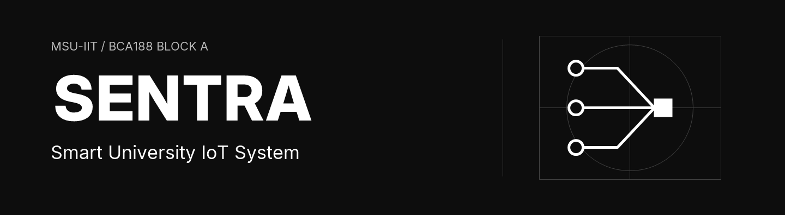
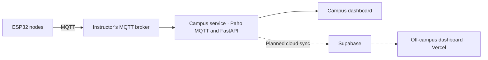

# SENTRA

We’re building SENTRA for our BCA188 Block A project at MSU-IIT. In our first campus field test, we’ll monitor conditions in one classroom, give instructors in two classrooms a way to ask for technician help, and show whether two parking bays are available.


[Subsystems](#what-sentra-does) · [Architecture](#how-data-reaches-the-dashboard) · [Node plan](#six-esp32-nodes) · [Contributing](CONTRIBUTING.md) · [Team & AI Guide](AGENTS.md) · [Testing](TESTING.md) · [Team](#team-contributions)

## What SENTRA does

| Subsystem | What it does |
| --- | --- |
|  **HAYAG** | Tracks temperature, humidity, light at the window and desk, and recent movement in one classroom. |
|  **ANDAM** | Gives instructors in two classrooms a help button. When SENTRA saves a ticket with the room name, a short beep alerts the technician. |
|  **KAHIMTANG** | Lets authorized faculty and staff check two monitored parking bays. A missing or stale reading shows **Unknown**. |

## How data reaches the dashboard

ESP32 nodes publish registered readings and events to the instructor’s MQTT broker. A Python service on campus validates the messages and makes them available to the local React dashboard. The planned off-campus view uses Supabase for stored readings and live updates, with Vercel hosting the web app. The campus service needs internet access to send those updates.



Keep class broker credentials in local configuration. The campus service connects to the broker using Block A’s assigned topics under `bca188/blocka/#`.

## Six ESP32 nodes

| Board | Station | Connected parts |
| --- | --- | --- |
| 1 | HAYAG climate and motion | SHT30-D temperature and humidity sensor and HC-SR501 motion sensor |
| 2 | HAYAG lighting | Two BH1750 light sensors at separate measurement points and a small LED for the field test |
| 3 | ANDAM Classroom 1 | Momentary help button and feedback LED |
| 4 | ANDAM Classroom 2 | Momentary help button and feedback LED |
| 5 | ANDAM technician desk | Three-pin active buzzer module |
| 6 | KAHIMTANG parking | Two HC-SR04 ultrasonic sensors, one per bay, each with an ECHO voltage divider |

Board numbers identify our working hardware layout. Final MQTT node IDs, locations, and owners belong in the team’s data registry.

## Getting started

Clone the repository to get a local copy.

```sh
git clone https://github.com/xavieryyyyyy/bca188-blocka-smart-university.git
cd bca188-blocka-smart-university
```

New contributors can start with the [team workflow](CONTRIBUTING.md) and find their ESP32 folder in the [station list](nodes/). The [team and AI instructions](AGENTS.md) explain what each station needs to finish before integration. Before the first MQTT test, assign a node owner and confirm its readings and topics in the [data registry](DATA_REGISTRY.md). Once the first sketch is ready, test it in Serial Monitor at 115200 baud, confirm its messages in MQTT Explorer, then check them on the dashboard. Use `secrets.h` for local ESP32 credentials and `.env` for local service settings.

## Field test

HAYAG, ANDAM, and KAHIMTANG build and test their stations in parallel. HAYAG checks its readings in the classroom. ANDAM checks that one button press creates one ticket for the correct room and causes one beep at the technician desk. KAHIMTANG tests each bay with and without a vehicle. Integrate each station with the dashboard as its messages are verified, and check that updates resume after reconnection.

Record what happened in the [test log](TESTING.md). Use the [data registry](DATA_REGISTRY.md) for measurements and node owners, the [security checklist](SECURITY.md) for access and privacy controls, and the [slides folder](slides/) for the final presentation PDF.

## Team contributions

SENTRA is the work of BCA188 Block A’s 19 members. Each student owns or co-owns a node or dashboard feature and records their work through their own Git commits. The team will record assignments alongside the field-test plan.

### ANDAM

- NERI, Kent Jesser A.
- MEJOS, GUIDO MANFRED G.
- BUALE, Aiza Kate D.
- ACOMPAÑADO, MICHE LOUIE B.
- SOCO, Justine Kyle O.

### KAHIMTANG

- CANAYAN, Shyane Novelle R.
- CADIZ, MICHAEL O.
- CASAS, Abigil Queen C.
- CASIM, GAZAWE G.
- TAHA, Amenodin A.

### HAYAG

- CASTOR, RHEA LEEN P.
- ALAWI, Rabbah I.
- MENDOZA, Emmery Kelsey V.
- VILIGANILAO, Caleb L.
- YBAÑEZ, ALLISON JELUCK S.
